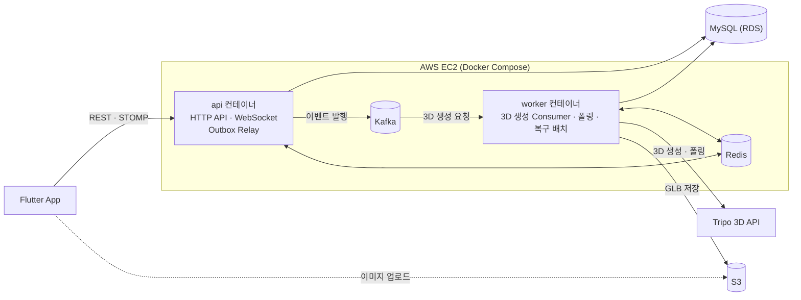

# GearShow

축구 장비(축구화·유니폼)의 실물 사진 4장으로 **3D 모델을 생성**해 360도로 보여주고, 상태 등급·착용 횟수 같은 **실사용 경험 데이터**를 함께 공유하는 쇼케이스 플랫폼입니다.

<br>

## 프로젝트 설명

중고 축구 장비는 평면 사진만으로 밑창 마모·스터드 상태·원단 손상을 판단하기 어렵습니다. GearShow는 사용자가 올린 앞/뒤/좌/우 사진을 외부 3D 생성 API(Tripo)로 보내 GLB 모델을 만들고, 앱에서 돌려 볼 수 있게 합니다.

- **쇼케이스**: 장비 등록 · 이미지 업로드 · 댓글 · 검색
- **3D 모델**: 4방향 사진 → 3D 모델 비동기 생성 → 앱 3D 뷰어로 확인
- **채팅**: 쇼케이스 기반 1:1 채팅 (WebSocket · STOMP)
- **카탈로그**: 축구화 · 유니폼 장비 카탈로그
- **인증**: 카카오 · Apple 소셜 로그인

<br>

## 기술 스택

| 구분 | 기술 |
|:--|:--|
| Backend | Java 21, Spring Boot 3.5, Spring Data JPA, Spring Security, Spring WebSocket(STOMP) |
| Messaging | Apache Kafka 3.9 (KRaft) |
| Cache / Coordination | Redis 7, Redisson |
| Database | MySQL 8 (AWS RDS) |
| Infra | AWS EC2 · S3 · ECR, Docker Compose, GitHub Actions |
| Observability | Prometheus, Grafana |
| Test | JUnit 5, Cucumber, Testcontainers, ArchUnit |
| Frontend | Flutter |
| Tools | Python (카탈로그 크롤러) |

<br>

## 아키텍처



- **단일 JAR, 두 역할**: 같은 이미지를 `api` / `worker` 프로파일로 나눠 실행합니다. API 응답 경로와 무거운 3D 생성 작업(외부 API 호출·폴링·재시도)의 자원을 분리했습니다.
- **비동기 3D 생성**: 쇼케이스 저장과 이벤트를 한 트랜잭션에 기록하고(Transactional Outbox), Kafka를 거쳐 worker가 처리합니다.
- **헥사고날 + DDD**: Bounded Context별로 `adapter → application → domain` 방향의 의존만 허용하고, ArchUnit 테스트로 빌드 단계에서 강제합니다.

<br>

## 프로젝트 구조

```
GearShow/
├── backend/                  Spring Boot 백엔드
├── frontend/                 Flutter 앱
├── tools/catalog-crawler/    카탈로그 크롤러 (Python)
├── loadtest/                 k6 부하 테스트
├── observability/            Prometheus · Grafana 설정
├── docs/                     PRD · API 명세 · ADR · 설계 문서
├── docker-compose.yml        로컬 인프라
└── docker-compose.prod.yml   운영 (EC2)
```

### Backend 패키지

```
com.gearshow.backend
├── showcase    쇼케이스 · 이미지 · 댓글 · 3D 생성
├── catalog     장비 카탈로그
├── chat        1:1 채팅
├── user        회원 · 소셜 로그인 · 토큰
├── admin       관리자
└── platform    공용 인프라 (Outbox · 멱등성)

<각 Context>
├── adapter/in      web · scheduler · event
├── adapter/out     persistence · redis · messaging · storage
├── application     port/in · port/out · service
└── domain          model · vo · exception  (Spring · JPA 의존 없음)
```
