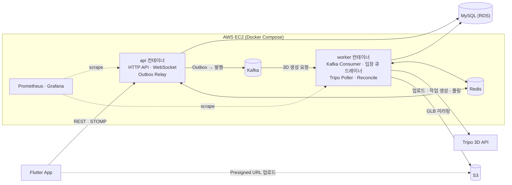
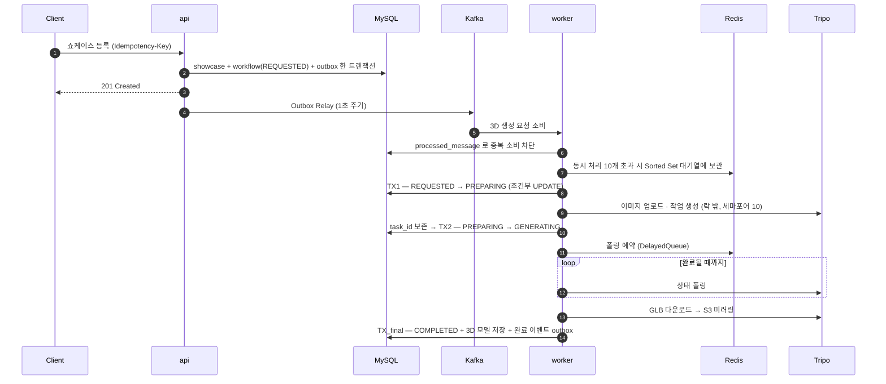
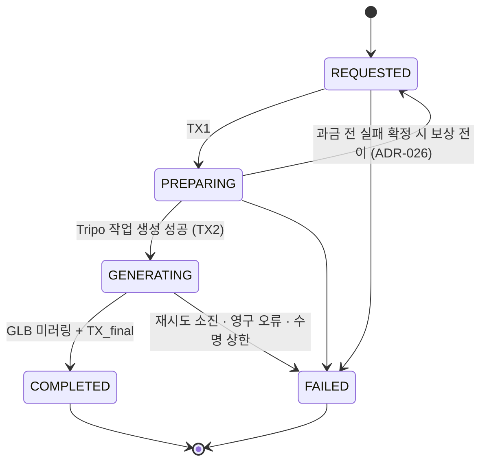
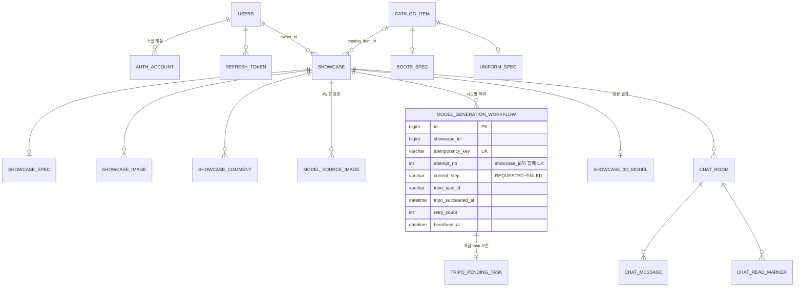
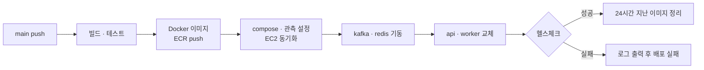

# GearShow

축구 장비(축구화·유니폼)의 실물 사진 4장으로 **3D 모델을 생성**해 360도로 보여주고, 상태 등급·착용 횟수 같은 **실사용 경험 데이터**를 함께 공유하는 쇼케이스 플랫폼입니다.

- **Backend**: Java 21 · Spring Boot 3.5 · 헥사고날 + DDD 모놀리스 (단일 JAR, `api` / `worker` 프로파일로 역할 분리)
- **Frontend**: Flutter 앱
- **개발**: 1인 개발 (백엔드 중심)

> 중고 장비는 평면 사진만으로 밑창 마모·스터드 상태·원단 손상을 판단하기 어렵습니다. GearShow는 앞/뒤/좌/우 사진을 외부 3D 생성 API(Tripo)로 보내 GLB 모델을 만들고, 앱에서 돌려 볼 수 있게 합니다.

<br>

## 목차

1. [주요 기능](#주요-기능)
2. [기술 스택](#기술-스택)
3. [시스템 아키텍처](#시스템-아키텍처)
4. [핵심 설계 — 3D 생성 파이프라인](#핵심-설계--3d-생성-파이프라인)
5. [데이터 모델](#데이터-모델)
6. [테스트와 품질 게이트](#테스트와-품질-게이트)
7. [성능 테스트](#성능-테스트)
8. [배포와 운영](#배포와-운영)
9. [로컬 실행](#로컬-실행)
10. [프로젝트 구조](#프로젝트-구조)
11. [문서](#문서)
12. [알려진 한계와 다음 단계](#알려진-한계와-다음-단계)

<br>

## 주요 기능

| 영역 | 기능 | 상태 |
|:--|:--|:--:|
| 인증 | 카카오 · Apple OAuth 로그인, JWT Access(1시간) / Refresh(14일) 토큰 | ✅ |
| 쇼케이스 | 등록·수정·삭제·목록·상세, Presigned URL 기반 S3 이미지 업로드, 댓글, 제목·설명 검색 | ✅ |
| 3D 모델 | 4방향 사진 → Tripo API로 생성 → GLB를 자체 S3로 미러링, 생성 상태 조회 · 재요청, 사용자별 일일 생성 횟수 제한 | ✅ |
| 채팅 | 쇼케이스 기반 1:1 채팅방, REST + WebSocket(STOMP), 읽음 처리 | ✅ (단일 서버 인메모리 브로커) |
| 카탈로그 | 장비 카탈로그 조회, 관리자 일괄 등록 API, Python 크롤러 | ✅ (앱 진입은 일시 비활성 — [ADR-024](docs/architecture/adr/ADR-024-showcase-search-simplification.md)) |
| 관리자 | 관리자 로그인, 역할 기반 권한(RBAC) | ✅ |
| 거래 · 결제 | 거래 티켓 패턴, 채팅/거래/결제 경계 설계 | ⏳ 설계만 ([ADR-006](docs/architecture/adr/ADR-006-transaction-ticket-pattern.md), [ADR-007](docs/architecture/adr/ADR-007-chat-transaction-payment-boundaries.md)) |

<br>

## 기술 스택

| 구분 | 기술 |
|:--|:--|
| Language / Framework | Java 21, Spring Boot 3.5, Spring Data JPA, Spring Security, Spring WebSocket(STOMP) |
| Messaging | Apache Kafka 3.9 (KRaft), Spring Kafka (`@RetryableTopic`, DLT) |
| Cache / Coordination | Redis 7, Redisson 3.31 (분산 락 · 세마포어 · DelayedQueue · Sorted Set) |
| Resilience | Resilience4j 2.2 (Tripo API Circuit Breaker) |
| Database | MySQL 8 (운영: AWS RDS) |
| Storage | AWS S3 (AWS SDK v2) |
| Infra / CI·CD | AWS EC2 · ECR, Docker Compose, GitHub Actions |
| Observability | Spring Actuator, Micrometer, Prometheus, Grafana, Node Exporter |
| Test / Quality | JUnit 5, Cucumber 7, Testcontainers, ArchUnit, JaCoCo, SonarCloud, k6 |
| Frontend | Flutter (`model_viewer_plus`, `stomp_dart_client`, Kakao SDK) |
| Tools | Python 카탈로그 크롤러 |

<br>

## 시스템 아키텍처



- **단일 JAR, 두 역할**: 같은 이미지를 `SPRING_PROFILES_ACTIVE=prod,api` / `prod,worker`로 띄웁니다. API 응답 경로와 무거운 3D 작업(외부 I/O·폴링·재시도)의 자원을 분리하고, 각 스케줄러의 소유 프로세스를 하나로 정했습니다. ([ADR-027](docs/architecture/adr/ADR-027-3d-worker-process-split.md))
- **Redis는 필수 인프라**: 분산 락·세마포어·폴링 큐·일일 quota가 Redis에 있으므로, 연결되지 않으면 부팅 단계에서 실패시킵니다(fail-fast). ([ADR-013](docs/architecture/adr/ADR-013-redis-as-mandatory-infra.md))

### 헥사고날 + DDD

Bounded Context별로 `adapter → application → domain` 방향의 의존만 허용하고, 이 규칙은 ArchUnit 테스트로 빌드 단계에서 강제합니다.

```
com.gearshow.backend
├── showcase   쇼케이스 · 이미지 · 댓글 · 3D 생성 파이프라인
├── catalog    장비 카탈로그 (축구화 / 유니폼 스펙)
├── chat       1:1 채팅
├── user       회원 · OAuth · 토큰
├── admin      관리자 · RBAC
└── platform   공용 인프라 (Transactional Outbox, 멱등성)

<context>
├── adapter/in        web · scheduler · event       (Driving Adapter)
├── adapter/out       persistence · redis · messaging · model3d · storage (Driven Adapter)
├── application       port/in(UseCase) · port/out · service
└── domain            model · vo · exception        (Spring · JPA 의존 없음)
```

- Aggregate 사이에는 JPA 연관관계를 두지 않고 **ID로만 참조**합니다.
- 도메인 모델과 JPA 엔티티를 분리해, 도메인 계층에는 Spring·JPA 의존이 없습니다.

<br>

## 핵심 설계 — 3D 생성 파이프라인

Tripo 호출은 **1회마다 과금**되고, 생성에 수 분이 걸리며, 실패 유형(429, 타임아웃, 서버 오류)이 다양합니다. 그래서 파이프라인 설계의 제약을 세 가지로 정했습니다.

> **① Tripo 이중 과금 0 · ② 최종 상태 유실 0 · ③ 단일 장애로 파이프라인 전체가 멈추지 않음**

### 처리 흐름



### 상태 머신



모든 상태 전이는 `UPDATE ... WHERE id = ? AND current_step = ?` 형태의 **조건부 UPDATE**로 수행하고, 영향받은 행이 0이면 다른 워커가 먼저 전이한 것으로 보고 작업을 중단합니다.

### 문제와 해결

| 문제 | 해결 | 근거 |
|:--|:--|:--|
| DB 커밋과 메시지 발행의 원자성 | **Transactional Outbox** — 업무 데이터와 이벤트를 한 트랜잭션에 저장하고, Relay가 1초 주기로 Kafka에 발행 | `platform/outbox` |
| 사용자 재시도 · 메시지 재전달로 인한 중복 | **4계층 멱등성** — ① `Idempotency-Key` 헤더 ② 쇼케이스 `content_hash` ③ `processed_message` 소비 이력 ④ `tripo_pending_task`로 과금된 task_id 보존 | [ADR-011](docs/architecture/adr/ADR-011-3d-pipeline-multilayer-idempotency.md) |
| 여러 워커의 동시 상태 전이 | 정합성의 최종 판정은 **조건부 UPDATE(CAS)**. Redisson 분산 락은 상태 전이 트랜잭션 구간에만 선택적으로 사용하고, 외부 I/O는 락 밖에서 수행 | [ADR-012](docs/architecture/adr/ADR-012-3d-pipeline-conditional-update-concurrency.md) |
| Tripo 동시 처리 한계(10) | Redis **세마포어(10)** 로 호출 상한을 지키고, 넘치는 요청은 **Sorted Set 입장 큐**(점수 = 대기 시작 시각)에 보관 → 드레이너가 빈 슬롯만큼 꺼내 Kafka에 재발행 | [ADR-025](docs/architecture/adr/ADR-025-3d-generation-admission-queue.md) |
| 일시 장애 재시도 | Kafka `@RetryableTopic` — 30초부터 최대 480초까지 지수 백오프, 5회 시도 후 DLT로 격리하고 workflow를 FAILED 처리 | `ModelGenerationWorker` |
| Tripo 장애 전파 | Resilience4j **Circuit Breaker** — 열린 상태의 호출 거부도 재시도 대상으로 분류 | — |
| 과금 전 실패가 재시도되지 않던 버그 | 미과금이 확정되면 **PREPARING → REQUESTED 보상 전이** 후 재시도 | [ADR-026](docs/architecture/adr/ADR-026-3d-preparing-retryable-compensation.md) |
| 서버 크래시로 멈춘 작업 | **Reconcile 배치(60초)** — heartbeat 기준으로 멈춘 workflow를 찾아 이어서 진행하거나 실패 처리 | [설계 문서 §8.4](docs/research/2026-04-23-3d-generation-pipeline-design.md) |
| 단일 스케줄러 스레드 기아 | 스케줄러 풀 크기 3 + api/worker 프로세스 분리 | [ADR-027](docs/architecture/adr/ADR-027-3d-worker-process-split.md) |
| 악성 사용자로 인한 비용 폭증 | 사용자별 **일일 생성 3회** (Redis TTL, KST 자정 초기화) | `application.yml` |
| 도메인 데이터와 처리 이력의 혼재 | 결과(`showcase_3d_model`)와 처리 과정(`model_generation_workflow`) 테이블 분리 | [ADR-010](docs/architecture/adr/ADR-010-3d-pipeline-table-split.md) |

<br>

## 데이터 모델

테이블 간 선은 FK 제약이 아니라 **ID 참조 관계**입니다.



공용 테이블 `outbox_message` · `processed_message` · `idempotency_key`는 특정 Aggregate에 속하지 않는 플랫폼 테이블이고, 관리자는 `admins` 테이블로 분리되어 있습니다.

<br>

## 테스트와 품질 게이트

| 항목 | 내용 |
|:--|:--|
| 아키텍처 테스트 | ArchUnit 4개 규칙 — domain의 Spring 의존 금지, domain의 JPA 의존 금지, domain → adapter 의존 금지, application → adapter 의존 금지 |
| 인수 테스트 | Cucumber `.feature` 13개 (BDD 시나리오) |
| 통합 테스트 | Testcontainers (MySQL · Kafka · Redis) — 분산 락 · 입장 큐 등 Redis 어댑터를 실제 컨테이너로 검증 |
| 커버리지 | JaCoCo 전체 70% 미만이면 `./gradlew check` 실패 |
| CI | PR마다 GitHub Actions에서 `./gradlew build` + SonarCloud 분석 |

```bash
./gradlew archTest   # 헥사고날 경계만 빠르게 검증
./gradlew check      # 전체 테스트 + archTest + 커버리지 70% 게이트
```

<br>

## 성능 테스트

쇼케이스 등록 API(3D 생성 제외)의 기준선을 k6로 측정했습니다. → [보고서](docs/performance/phase0-baseline.md)

- **환경**: 2026-04-11, EC2 t3.small (2 vCPU / 2 GB), RDS MySQL 8, Kafka · 관측 스택 동일 인스턴스
- **결과**: 400 VU까지 에러 0%였지만 처리량은 **약 110 RPS에서 정체**되고 p99는 8초대까지 증가

| SLO 기준 | 수용 범위 |
|:--|:--|
| p99 < 500ms | 약 30 VU / 35 RPS |
| **p99 < 1s (권장 SLO)** | **약 50 VU / 80 RPS** |
| p99 < 3s | 약 150 VU / 105 RPS |

- **1차 병목은 CPU**(2 vCPU 100%)였고, HikariCP 대기는 CPU 포화에 따라온 2차 현상이라 풀 크기를 늘려도 효과가 제한적이라고 판단했습니다.
- "에러 0%"가 건강함을 뜻하지 않는다는 점, 즉 서버 내부 큐가 요청을 붙잡고 지연으로 버티는 구간을 지표로 확인했습니다.
- 현재 운영 인스턴스는 t3.medium(4 GB)입니다.

<br>

## 배포와 운영



- **헬스체크**: api는 `GET /api/v1/health`, worker는 외부 포트 없이 Docker healthcheck(`/actuator/health/liveness`)로 확인합니다. 두 역할이 모두 통과해야 배포 성공입니다.
- **롤백 경로**: 24시간 이내 이미지는 지우지 않아 직전 버전으로 되돌릴 수 있습니다.
- **메모리 예산**: 한 대의 EC2(4 GB)에서 컨테이너별 `mem_limit`과 JVM 힙을 고정했습니다.

| 컨테이너 | JVM Heap | mem_limit |
|:--|:--:|:--:|
| api | 384 MB | 800 MB |
| worker | 320 MB | 730 MB |
| Kafka | 256 MB | — |
| Redis | — | 192 MB |
| Prometheus / Grafana / Node Exporter | — | 256 / 192 / 64 MB |

- **관측**: `/actuator/prometheus`로 JVM · HTTP · DB · Kafka 지표와 3D 파이프라인 커스텀 지표를 노출하고, HTTP 지연은 히스토그램 + SLO 버킷(100ms · 300ms · 500ms · 1s · 3s)으로 수집합니다.

<br>

## 로컬 실행

**필요 도구**: JDK 21, Docker, (앱 실행 시) Flutter SDK

```bash
# 1) 로컬 인프라 — MySQL 8.0, Kafka 3.9(KRaft), Redis 7.4, Prometheus, Grafana
docker compose up -d

# 2) 환경변수 — 값을 채워 넣는다
cp backend/.env.example backend/.env

# 3) 백엔드 실행 (bootRun 이 backend/.env 를 읽는다, 기본 프로파일 local)
cd backend && ./gradlew bootRun

# 4) Flutter 앱
bash scripts/run-frontend.sh --env=dev
```

| 설정 | 설명 |
|:--|:--|
| `KAFKA_ENABLED=true`, `KAFKA_BOOTSTRAP_SERVERS=localhost:9092` | 3D 생성 비동기 경로(Outbox Relay → Worker)를 켭니다 |
| `TRIPO_ENABLED=false` (기본) | `FakeModelGenerationClient`가 동작해 **과금 없이** 파이프라인을 확인할 수 있습니다 |
| `AWS_S3_*` | 이미지 · GLB 저장용 버킷. `AWS_S3_ENDPOINT`로 S3 호환 엔드포인트를 지정할 수 있습니다 |
| `POST /api/v1/auth/dev-login` | `local` · `dev` · `test` 프로파일 전용 개발 로그인 |

- Redis가 없으면 부팅에 실패합니다. `./gradlew test`도 Redis(6379)와 Docker(Testcontainers)가 필요합니다.
- 로컬 관측 스택: Prometheus `localhost:9090`, Grafana `localhost:3000`

<br>

## 프로젝트 구조

```
GearShow/
├── backend/                  Spring Boot 백엔드 (단일 JAR, api / worker 프로파일)
├── frontend/                 Flutter 앱
├── tools/
│   ├── catalog-crawler/      카탈로그 크롤러 (Python)
│   └── hooks/                개발 하네스 훅 (worktree · 실행 계획 · 위험 명령 차단)
├── loadtest/                 k6 시나리오 · 결과
├── observability/            Prometheus 설정 · Grafana 프로비저닝
├── docs/                     PRD · API 명세 · ADR · 설계 문서 · 성능 보고서
├── docker-compose.yml        로컬 인프라
└── docker-compose.prod.yml   운영 (EC2)
```

<br>

## 문서

| 문서 | 경로 |
|:--|:--|
| 제품 요구사항 (PRD) | [docs/PRD.md](docs/PRD.md) |
| API 명세 | [docs/spec/api-spec.md](docs/spec/api-spec.md) |
| 비즈니스 규칙 | [docs/business/biz-logic.md](docs/business/biz-logic.md) |
| 아키텍처 결정 기록 (ADR) | [docs/architecture/adr/](docs/architecture/adr/) |
| 3D 생성 파이프라인 설계 | [docs/research/2026-04-23-3d-generation-pipeline-design.md](docs/research/2026-04-23-3d-generation-pipeline-design.md) |
| 성능 기준선 보고서 | [docs/performance/phase0-baseline.md](docs/performance/phase0-baseline.md) |

**주요 ADR**

| ADR | 결정 |
|:--|:--|
| [005](docs/architecture/adr/ADR-005-chat-protocol.md) | 채팅 프로토콜 — WebSocket + STOMP |
| [010](docs/architecture/adr/ADR-010-3d-pipeline-table-split.md) | 3D 파이프라인 — 도메인 / 프로세스 테이블 분리 |
| [011](docs/architecture/adr/ADR-011-3d-pipeline-multilayer-idempotency.md) | 3D 파이프라인 — 다층 멱등성 |
| [012](docs/architecture/adr/ADR-012-3d-pipeline-conditional-update-concurrency.md) | 3D 파이프라인 — 선택적 분산 락 + 조건부 UPDATE |
| [013](docs/architecture/adr/ADR-013-redis-as-mandatory-infra.md) | Redis 필수 인프라 격상 |
| [014](docs/architecture/adr/ADR-014-admin-rbac.md) | 관리자 RBAC |
| [025](docs/architecture/adr/ADR-025-3d-generation-admission-queue.md) | 3D 생성 입장 큐 — 재발행 방식 |
| [026](docs/architecture/adr/ADR-026-3d-preparing-retryable-compensation.md) | PREPARING 재시도 실패 보상 전이 |
| [027](docs/architecture/adr/ADR-027-3d-worker-process-split.md) | 3D Worker 프로세스 분리 |

### 개발 방식

AI 코딩 에이전트(Claude Code)와 함께 개발하면서, 품질이 흔들리지 않도록 저장소에 하네스를 두었습니다.

- `main` 직접 수정 금지 → 작업마다 git worktree와 실행 계획(EXEC_PLAN)을 먼저 만들어야 코드 편집이 허용됩니다.
- 작업 종료 시 빌드 · 아키텍처 테스트를 자동 실행하고, 실패하면 최대 3회까지 스스로 수정합니다.
- PR은 내부 리뷰 에이전트(아키텍처 · 코드 품질 · DB) + CodeRabbit 리뷰를 반영한 뒤 머지합니다.

<br>

## 알려진 한계와 다음 단계

- **Kafka 단일 브로커(복제 계수 1)**: `acks=all`이어도 복제본이 없어 브로커 디스크 장애 시 메시지를 잃을 수 있습니다. 관리형 Kafka(MSK) 전환 시 `min.insync.replicas=2`로 올릴 계획입니다.
- **입장 큐의 동시 처리 10은 소프트 상한**: 여러 판단이 동시에 일어나면 잠시 초과할 수 있고, 실제 Tripo 호출 수는 세마포어(10)가 강제합니다.
- **채팅은 단일 서버 인메모리 브로커**: 서버를 여러 대로 늘리려면 외부 브로커로 전환해야 합니다 (ADR-005 Phase 3).
- **취소할 수 없는 Tripo 작업**: Tripo 작업 생성 직후 task_id 저장이 실패하거나 워커가 죽으면, Tripo에 취소 API가 없어 그 작업이 백그라운드에서 완료되며 1회분 크레딧이 손실됩니다. Reconcile이 `failure_code=TX2_DB_FAILED`로 실패 처리해 사후에 감지합니다.
- **3D 완료 알림 미구현**: 완료 이벤트는 Kafka 토픽까지 발행하지만, 이를 소비해 푸시(FCM)를 보내는 소비자는 아직 없습니다.
- **거래 · 결제 미구현**: 설계(ADR-006, ADR-007)까지 완료된 상태입니다.
